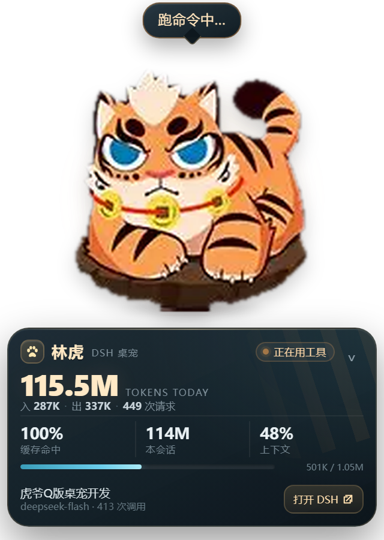
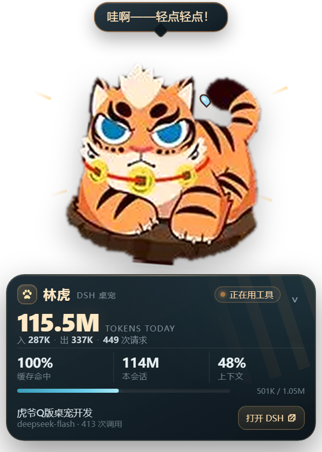

# 林虎 · DSH 桌宠

一只常驻桌面的 Q 版林虎（《家有大猫 / Nekojishi》虎爷），会盯着 DeepSeek Harness（DSH）的会话日志，实时显示 token 消耗、上下文占用和当前工作状态。



> 非官方同人作品。林虎 / 家有大猫的角色版权归原权利方所有，请勿商用。

## 功能

- **常态信息面板**：今日 token 总吞吐、输入 / 输出、请求次数、缓存命中率、本会话 token、上下文百分比与进度条。
- **Q 版林虎形象**：橙色虎纹、白色口吻和胸毛、蓝眼睛、黑眉毛、红绳金币项圈，趴在深棕色圆垫上；按你提供的参考图做成透明 PNG。
- **实时状态**：打盹、思考中、跑命令、写文件、等你确认、搞定啦、出错了；状态变化时头顶会冒小气泡。
- **拖拽移动**：按住林虎拖动，整只虎和垫子会一起左右晃，身边冒出小汗滴，气泡变成「哇啊——轻点轻点！」，松手落地还会压扁一下。
- **贴边吸附**：拖到屏幕边缘会自动贴边；位置会记住，下次启动回到原处。默认停在右上角，避免挡住 DSH 底部的输入框；窗口整体 320×450，比之前小了一圈。
- **收纳面板**：点右上角的 `⌄` 收起面板，只留一个 `今日 tokens` 小胶囊；点胶囊展开。
- **托盘常驻**：托盘菜单可以显示 / 隐藏、置顶、刷新数据、重置到右上角 / 右下角、开机启动、退出。
- **打开 DSH**：点“打开 DSH”会把正在运行的 DeepSeek Harness 窗口切到前台。
- **纯本地**：只读取 `%USERPROFILE%\.dsh\sessions` 下的会话日志，不联网、不读取凭据。



## 下载即用（GitHub Release）

从 GitHub Releases 下载：

```text
LinhuPet-Windows-x64-v1.0.0.zip
```

**整个压缩包一起解压**到任意目录（不要只把 `LinhuPet.exe` 拖出来，`resources/`、`locales/` 和 DLL 必须和它放在一起），然后双击：

- `LinhuPet.exe`，或
- `启动林虎桌宠.bat`

如果 Windows 提示 SmartScreen，选择“更多信息 → 仍要运行”。

发行包是便携版，不写注册表、不创建服务、不自动开机启动；DSH 没有运行也能启动，但没有日志时只会显示“等待 DSH 数据”。

## 安装到本机（可选）

在 PowerShell 中运行：

```powershell
powershell -NoProfile -ExecutionPolicy Bypass -File .\install.ps1
```

它会：

1. 把程序复制到 `%LOCALAPPDATA%\Programs\LinhuPet`；
2. 在桌面和开始菜单创建“林虎桌宠”快捷方式；
3. 启动桌宠。

设置和位置保存在 `%APPDATA%\LinhuPet\state.json`，升级时不会丢。

卸载已安装版：

```powershell
powershell -NoProfile -ExecutionPolicy Bypass -File .\uninstall.ps1
```

如果要连配置和缓存一起删除：

```powershell
powershell -NoProfile -ExecutionPolicy Bypass -File .\uninstall.ps1 -RemoveData
```

便携版不需要安装脚本，卸载方式：

1. 托盘右键 → 退出；
2. 删除解压出来的 `LinhuPet` 文件夹；
3. 可选：删除 `%APPDATA%\LinhuPet`（配置和缓存）。

## 操作

| 操作 | 效果 |
|---|---|
| 按住林虎拖动 | 移动桌宠，进入可爱拖拽状态 |
| 单击林虎 | 随机说一句话 |
| 双击林虎 | 展开 / 收起信息面板 |
| 点击右上角 `⌄` | 收起面板 |
| 点击底部胶囊 | 展开面板 |
| 右键 | 打开菜单 |
| 托盘左键 | 显示 / 隐藏 |
| 托盘右键 | 完整菜单 |

## 数据口径

- 数据来自 DSH v4 会话日志：`%USERPROFILE%\.dsh\sessions\<工作区>\session-*\session.v*.jsonl.zstd`，支持多帧 zstd。
- **今日 tokens** = 当日所有会话的 `totalTokens` 之和，包含缓存读取（cache read）。缓存命中率按 `cacheRead / (cacheRead + uncachedInput)` 计算。
- **本会话** = 当前最近活动会话的累计 `totalTokens`。
- **上下文** = 最近一次请求的 `totalTokens / contextWindow`；`contextWindow` 从日志里的 `request/context` 事件读取（当前 DeepSeek Flash 为 1,048,576）。
- 活跃会话按最近事件时间选择；如果有多个 DSH 会话，面板显示最近在动的那个，今日统计则汇总所有会话。
- 刷新间隔约 1.4 秒。DSH 正在写日志时会自动跳过未写完的行。

## 构建

要求：Windows、已安装 DeepSeek Harness Desktop，Node 仅用于开发辅助（运行时不需要单独安装 Node）。

```powershell
powershell -NoProfile -ExecutionPolicy Bypass -File .\build.ps1
```

可选参数：

```powershell
powershell -NoProfile -ExecutionPolicy Bypass -File .\build.ps1 -DshRoot 'C:\Program Files\DeepSeek Harness' -OutDir '.\dist\LinhuPet'
```

构建产物使用 DSH 自带的 Electron 运行时（避免额外下载 300MB 的 Electron），所以**构建机**需要有 DSH Desktop 的安装文件；发布包已经带运行时，下载用户不需要安装 DSH，但没有 DSH 日志时只会显示“等待 DSH 数据”。

## 目录

```text
linhu-pet/
  assets/           参考图处理后的林虎 PNG、托盘图标
  src/main.cjs      Electron 主进程、窗口、拖拽、托盘、DSH 窗口聚焦
  src/monitor.cjs   DSH 会话日志解析与 token 统计
  src/renderer.js   面板、气泡、拖拽交互
  src/styles.css    桌宠与面板样式
docs/               截图
build.ps1           打包脚本
install.ps1         安装脚本
uninstall.ps1       卸载脚本
```

## 素材说明

形象完全按你提供的参考图处理：先用脚本把白底抠成透明、裁掉多余留白、放大并锐化，保存为 `linhu-pet/assets/linhu.png`；托盘图标从同一张图裁出头像。之前那套站立、穿马甲的林虎 SVG 已经移除，不再作为桌宠形象。

如果你之后想换更清晰的同角色大图，只需替换 `assets/linhu.png` 并重新运行 `build.ps1`。

## 已知限制

- 仅支持 Windows（透明窗口、托盘、窗口聚焦按 Windows 实现）。
- 使用本机已安装的 DSH Electron 运行时打包；安装后的桌宠自带运行时副本，DSH 卸载后仍可启动，但没有新日志时只会显示“等待 DSH 数据”。
- 今日统计包含缓存读取，数字会比“计费输入 + 输出”大很多；面板同时显示输入 / 输出和缓存命中率。
- “打开 DSH”依赖 DSH 窗口标题 / 进程名；如果 DSH 改了进程名，会回退为打开本地 Web 地址。
- 桌宠窗口是透明但非穿透的：在空白透明区域点击不会落到桌面。当前窗口尺寸 320×450，透明边距很小。

## 许可与第三方说明

- 项目源代码和文档：MIT，见 [LICENSE](LICENSE)。
- 林虎 / 《家有大猫》角色与参考图版权归原权利方，**本项目不授予角色商用或再分发权**。
- 发行包里的 Electron 运行时来自本机安装的 DeepSeek Harness Desktop；Electron 使用 MIT 许可，完整的 Chromium/Electron 许可文本已随包附带。DeepSeek Harness 及其标识归 DeepSeek，本项目与 DeepSeek 无隶属关系。
- 更完整的说明见 [THIRD_PARTY_NOTICES.md](THIRD_PARTY_NOTICES.md)。

公开发布前请确认你有权分发角色图片和随包的 DSH Electron 运行时；如果没有，建议只发布源码，让使用者用自己的 DSH 安装构建。
